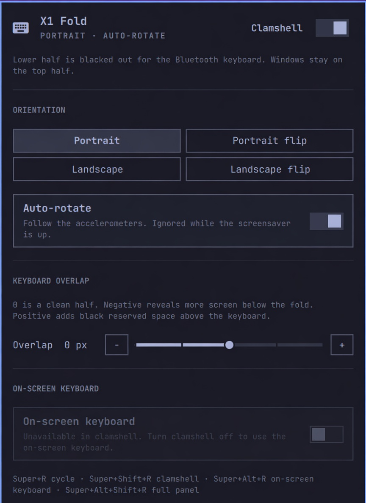

# X1 Fold

An [Omarchy](https://omarchy.org/) shell plugin for the **Lenovo ThinkPad X1 Fold 16 Gen 1**.

It treats the folding OLED as a real posture, not just a rotated monitor: any of the four orientations, a clamshell “keyboard on glass” mode that blacks out the lower half, auto-rotate from the chassis accelerometers, and an on-screen keyboard for tablet use.



<p align="center"><sub>Settings panel (Tokyo Night). Left-click the bar widget to open it.</sub></p>

## What it does

**Clamshell** is the mini-laptop posture. Fold the panel, set the Bluetooth keyboard on the lower half, and work on the top half only. The plugin:

- Reserves that lower region so tiled windows cannot sit under the keys
- Insets full-screen overlays (Omarchy menu, clipboard, emoji picker, OSD, …) into the same usable half so they center on the active area, not the physical OLED
- Turns client fullscreen (YouTube, Super+F) into maximize-inside-the-half: the app still thinks it is fullscreen, Hyprland keeps the reserved keyboard region
- Maps the screensaver as a floating half-height window (a named Hyprland rule, so it never flashes covering-fullscreen). TTE then measures the visible pty. Other windows stay put because it never joins dwindle.
- Insets Quickshell overlay surfaces (menu, theme/wallpaper picker, clipboard, …) to the same usable half so they center on the viewable area. Other plugins can read `omarchy-shell mattd.x1fold usableArea`.

There is no xrandr-style crop on this panel. The Wayland equivalent is `hl.monitor({ mode = "…" })`, but the OLED only advertises `2024×2560@60`, and Intel’s scaler can only Full / Center / Full-aspect a smaller mode — it cannot pin a half-height framebuffer to the top. So clamshell is a compositor reserved region plus a true-black overlay, not a different video mode.

Covering fullscreen always uses the whole output; `reserved_area` does not apply to it. The screensaver therefore maps already sized to the visible half via a window rule, instead of going fullscreen and hoping Hyprland clips it.
- Paints the covered half true black (`#000000`) on an Overlay layer so those OLED pixels turn off
- Swallows input on the covered half
- Turns the on-screen keyboard off (you already have hardware keys)

There is no separate “mini-laptop” mode. That name is an alias of `clamshell on`.

**Full panel** (tablet) is the other posture: the whole OLED is the desktop. Rotate it to any of the four orientations. Use Squeekboard when the hardware keyboard is away.

**Auto-rotate** reads the two `accel_3d` IIO sensors. It is paused while the screensaver is up, and for a few seconds after, so a noisy sample cannot flip the desktop on wake.

Omarchy’s idle-wake path re-enables the internal panel *without* a transform, and this OLED is natively portrait. The plugin watches screensaver dismiss, DPMS restore, and `monitoradded` / `configreloaded`, then puts the saved orientation back.

## Requirements

- Omarchy 4 with Hyprland (Lua config: `hyprctl eval "hl.monitor({...})"`)
- ThinkPad X1 Fold 16 Gen 1 (Sharp 2024×2560 OLED, `eDP-1`)
- Optional: ThinkPad Bluetooth TrackPoint Keyboard
- Optional: [Squeekboard](https://gitlab.gnome.org/World/Phosh/squeekboard) for the on-screen keyboard

Other folding PCs are untested. The accelerometer map and native portrait panel are specific to this chassis.

## Install

From this repo:

```bash
git clone <this-repo> ~/projects/omarchy/x1fold-plugin
cd ~/projects/omarchy/x1fold-plugin
./setup.sh
```

`setup.sh` will:

1. Symlink this checkout to `~/.config/omarchy/plugins/mattd.x1fold`
2. Put `x1fold` on your `PATH` (`~/.local/bin/x1fold`)
3. Enable the bar widget (right section)
4. Install keybindings, Squeekboard autostart, layer rules, and Omarchy menu entries
5. Restart the Omarchy shell

To also install Squeekboard and the Bluetooth-keyboard-at-LUKS initramfs hook (needs `sudo` in a terminal):

```bash
./setup.sh --boot
```

Once the repo is on git hosting, you can also clone it through Omarchy:

```bash
omarchy plugin add <git-url> --enable
# still run setup.sh from the clone for keybindings / OSK / layer rules
```

Uninstall desktop integration (does not delete this checkout):

```bash
./setup.sh --uninstall
```

## Usage

### Bar widget

Lives in the right section of the Omarchy bar.

| Click | Action |
| --- | --- |
| Left | Open the panel |
| Right | Toggle clamshell |
| Middle | Cycle orientation |

### Keybindings

| Shortcut | Action |
| --- | --- |
| <kbd>Super</kbd>+<kbd>R</kbd> | Cycle orientation |
| <kbd>Super</kbd>+<kbd>Shift</kbd>+<kbd>R</kbd> | Toggle clamshell |
| <kbd>Super</kbd>+<kbd>Alt</kbd>+<kbd>R</kbd> | Toggle on-screen keyboard |
| <kbd>Super</kbd>+<kbd>Alt</kbd>+<kbd>Shift</kbd>+<kbd>R</kbd> | Full panel (clamshell off) |

The Omarchy menu also has a **Hardware → X1 Fold** submenu.

### CLI

```bash
x1fold status
x1fold rotate portrait|portrait-flip|landscape|landscape-flip|cycle
x1fold clamshell on|off|toggle
x1fold osk on|off|toggle
x1fold autorotate on|off|toggle
x1fold overlap 0          # -50..50, snapped to 5 px
x1fold cover-ratio 0.50
x1fold tablet             # clamshell off
x1fold apply
```

`x1fold status` prints JSON (orientation, reserved pixels, monitor, …).

## Clamshell overlap

**Overlap** is extra reserved space on top of the half-screen split, from **−50 to +50** logical pixels. **0** is a clean half.

- **Negative** reveals more screen below the fold.
- **Positive** adds black reserved space above the keyboard, for the top/back edge of the ThinkPad Bluetooth keyboard.

The panel slider steps by 5 px, with − / + on either side. The same value is `x1fold overlap N`.

## On-screen keyboard

Squeekboard is started with the session (`SQUEEKBOARD_FORCE=1` so it is allowed on a non-phone form factor). Super+Alt+R shows or hides it.

It is forced off while clamshell is on — that posture already has a hardware keyboard — and the panel toggle is greyed out in that mode.

## Bluetooth keyboard at the LUKS prompt

The root filesystem is encrypted. After pairing the ThinkPad keyboard in the running system, install the initramfs hook once:

```bash
./setup.sh --boot
# or: ~/.config/omarchy/plugins/mattd.x1fold/bin/x1fold-install-boot-keyboard
```

That copies a `bluetoothkbd` mkinitcpio hook (before `encrypt`), includes `/var/lib/bluetooth` pairing data, enables `AutoEnable` in `bluetoothd`, and rebuilds the initramfs. USB still works as a fallback if Bluetooth is slow to come up. Keep the keyboard in range during the passphrase prompt; it may buffer a couple of seconds of keystrokes.

## Book mode (not implemented)

Lenovo’s “book mode” is a different fold: stand the device up like an open hardcover, hinge running vertically down the middle, both halves visible. The use case is reading or proofing — two pages side by side — without a keyboard on the glass. It is not clamshell.

Doing it well needs a working hinge angle so the compositor can put a gap on the crease. This machine’s HID hinge still reports 0°. Left as a later feature.

## Layout

Omarchy loads user plugins from `~/.config/omarchy/plugins/<id>/`. This repo *is* that plugin (`manifest.json` at the root), so `omarchy plugin add` and a development symlink both work.

```
x1fold-plugin/
├── manifest.json          Omarchy plugin id mattd.x1fold
├── Service.qml            Daemon, IPC, OLED mask layer
├── BarWidget.qml          Bar icon
├── Panel.qml              Settings panel
├── bin/x1fold             Posture CLI (Python)
├── initcpio/              bluetoothkbd hook for LUKS
├── contrib/               Hyprland + menu snippets setup.sh installs
├── setup.sh               Install / uninstall
├── screenshots/panel.png
└── LICENSE                MIT
```

Runtime state (not in git) lives at `~/.local/state/omarchy/x1fold/state.json`. The live Hyprland transform is also persisted in a marked block at the end of `~/.config/hypr/monitors.lua` so it survives compositor reload.

### Development

```bash
# edit this checkout; Omarchy hot-reloads QML on save
# if the panel looks stale:
omarchy restart shell
```

`setup.sh` points `~/.config/omarchy/plugins/mattd.x1fold` at this directory, so the checkout *is* the live plugin.

## License

[MIT](LICENSE) © 2026 dubhagen
